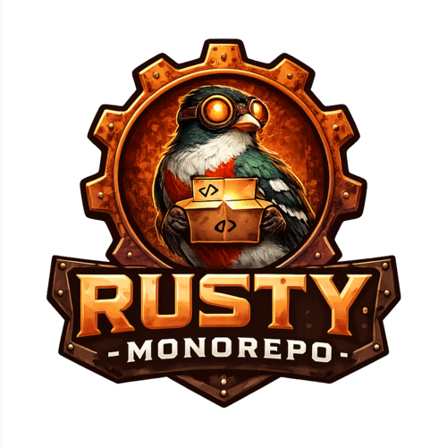

   

# Rusty MonoRepo

A Rust-based monorepo for building multiple projects.

## Projects

- [`trg`](crates/trg/README.md): see the [`trg` documentation](crates/trg/docs/README.md).
- [`trogon_dylint_lints`](crates/trogon_dylint_lints/README.md): a [Dylint](https://github.com/trailofbits/dylint) library of Rust policy lints.
- [`trogon_object_id`](crates/trogon_object_id/README.md): domain-specific prefixed identifiers with compile-time type and union checks.
- [`trogon_uuid`](crates/trogon_uuid/README.md): static UUIDv5 identity recipes with typed inputs.
- [`trogon_uuid_build`](crates/trogon_uuid_build/README.md): build-time Rust recipe generation from protobuf options.

## Licensing

New Rust crates use the workspace's Apache-2.0 license. Package-specific licenses
are declared in crate manifests and local `LICENSE` files. The root
[MIT license](LICENSE) applies to repository files without a more specific license.
See [Contributing](CONTRIBUTING.md#licensing) when adding a crate.
